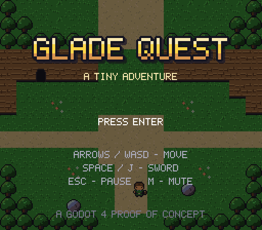
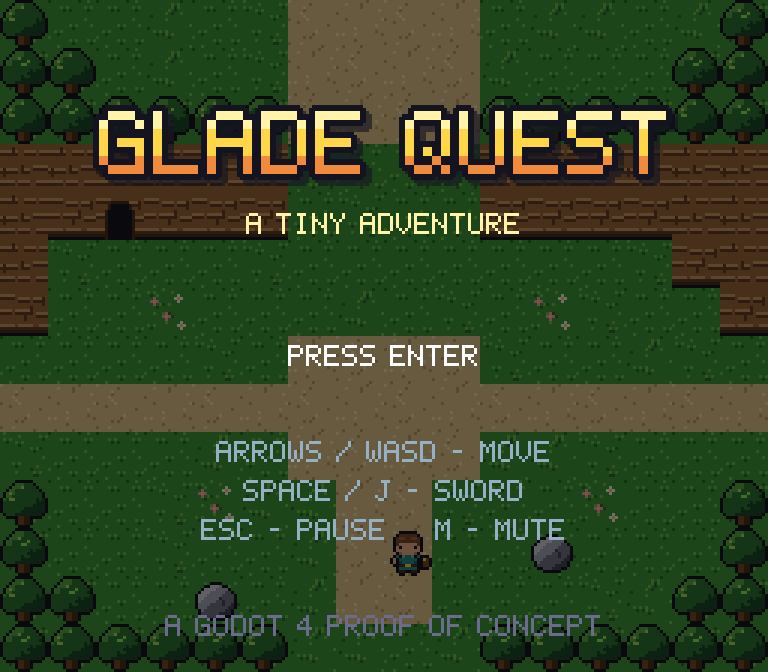
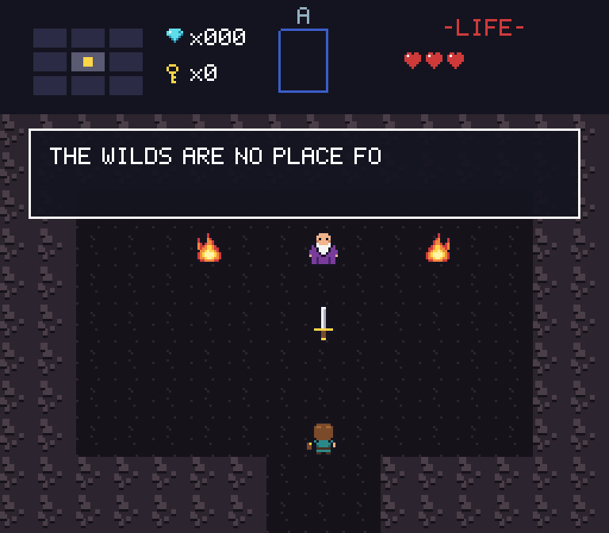
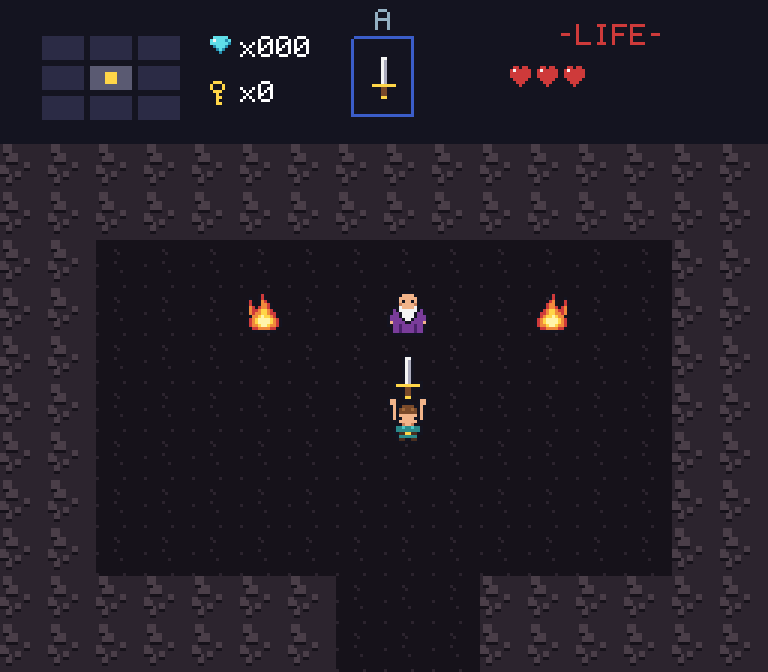
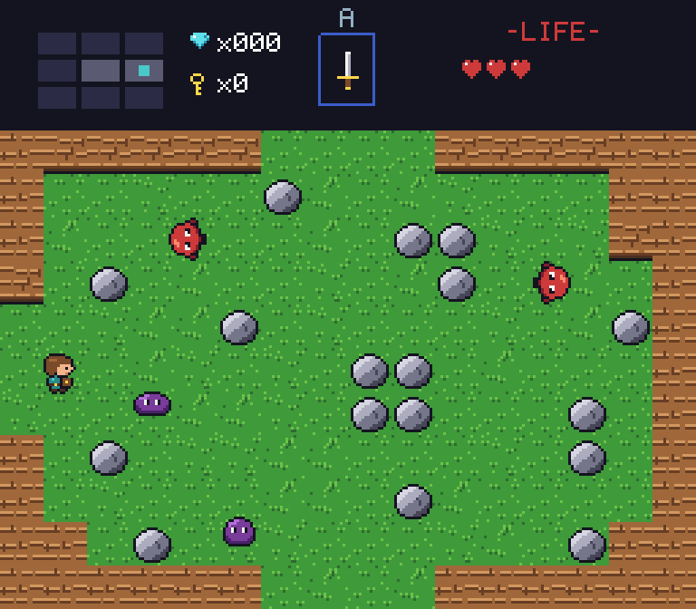
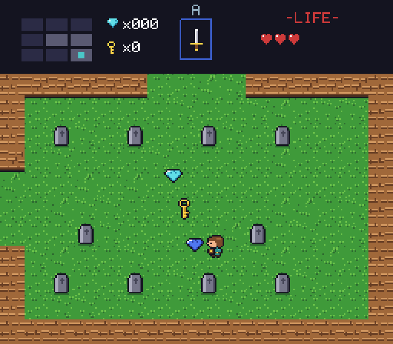
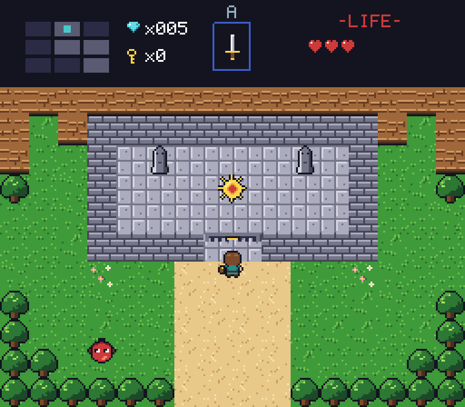
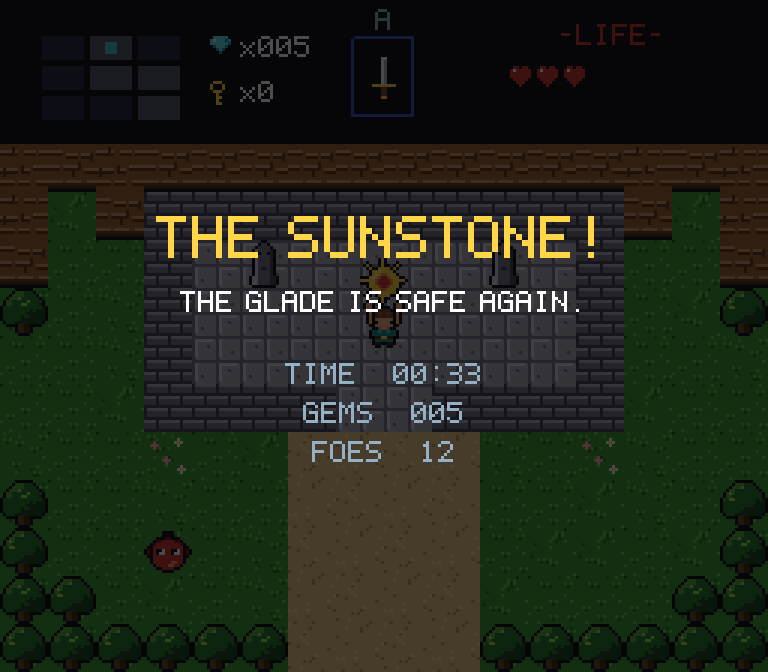
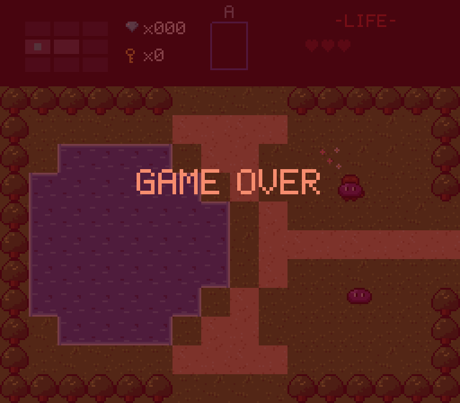

# Glade Quest

A tiny top-down action-adventure: a proof of concept in **Godot 4**, inspired by the 8-bit classics. It has a small overworld, one cave, sword fights, a key-and-gate puzzle and a win screen.
**Every sprite, tile, font glyph, sound effect and music note is generated by code in this repo.**



## Play it

1. Install **Godot 4.6 or newer** (standard build; tested on 4.6.3 and 4.7.2).
2. Open `project.godot` in Godot and press **F5**.
   On the very first open, Godot imports the assets. Any "resource not found" messages during that first import are expected and go away once it finishes.

| Action | Keyboard | Gamepad |
|---|---|---|
| Move | Arrows / WASD | D-pad / left stick |
| Sword | Space / J / Z | A / X |
| Start, confirm | Enter / Space | A / Start |
| Pause | Esc / P | Start |
| Mute · fullscreen | M · F11 | |

## The quest (light spoilers)

You start in a safe glade. An old sage in the cave hands you a sword. The shrine to the north holds the Sunstone behind a locked gate; its key appears once you defeat every guardian of the old graveyard in the south-east. Expect purple slimes that chase you and red spitters that shoot rocks. Face a rock head-on and your shield blocks it.

| | | | |
|---|---|---|---|
|  |  |  |  |
|  |  |  |  |

## What's in the box

- **Classic room-by-room overworld**: 3×3 screens with NES-style scrolling transitions, per-room enemy respawns, and a warp into a cave with its own music.
- **Responsive hero**:
  - 8-way movement with sticky 4-way facing
  - corner-slide assist, so 1-tile gaps are forgiving
  - sword hitbox, knockback with i-frames, shield blocking
  - "hold the item overhead" fanfare pose
- **Data-driven enemies**: one tested brain, two variants (chaser and shooter), loot drops.
- **UI**: hand-drawn HUD with minimap and hearts, typewriter dialog, title, pause, game over and victory screens.
- **Level as text**: `dev/world_map.txt` is baked into a real Godot scene by an in-engine builder. The builder **validates** the map first: room seams match, world edges have no holes, and everything is reachable.
- **Assets as code**: `tools/generate_assets.py` draws the pixel art (text-grid sprites, procedural tiles), writes a BMFont, and synthesises chiptune SFX and two looping music tracks. Output is deterministic.
- **Automated end-to-end playtest**: plays the whole quest with simulated input and checks 37 assertions in ~1 s headless. It also captures the screenshots and GIF above.

## Develop

```bash
# Regenerate art + audio (Python 3.10+, Pillow, numpy), then let Godot import them
python3 tools/generate_assets.py
godot --headless --path . --import

# Rebuild the world after editing dev/world_map.txt (validates first)
godot --headless --path . res://dev/build_world.tscn

# Run the end-to-end playtest (exit code 0 = all checks passed)
godot --headless --fixed-fps 60 --path . res://dev/playtest.tscn

# Lint
gdlint scripts dev && ruff check tools
```

**[docs/ARCHITECTURE.md](docs/ARCHITECTURE.md)** has the full write-up: structure, runtime architecture (scene tree, flow state machine, event bus), physics layers, the world and asset pipelines, tool picks and why, libraries, testing, and how to extend it.

## Code review of `game-dev-studio-zelda`

A review and repo map of the sibling repo [rogerolowski69/game-dev-studio-zelda](https://github.com/rogerolowski69/game-dev-studio-zelda) (Godot 3D prototype + TON NFT bridge + Tact contracts) is in **[docs/review/game-dev-studio-zelda-review.md](docs/review/game-dev-studio-zelda-review.md)**. It comes with tested fix patches and the scripts used to reproduce every finding.

## Credits

The game's code and every asset were created for this project. The art and audio are generated by `tools/`, and no third-party assets are used. `docs/review/` quotes and patches code from the reviewed repository. No license file has been added yet; that's the owner's call.
