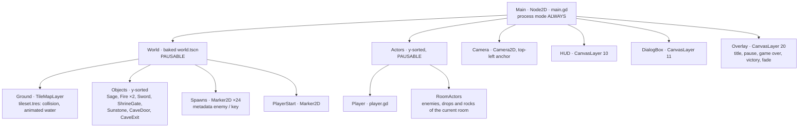
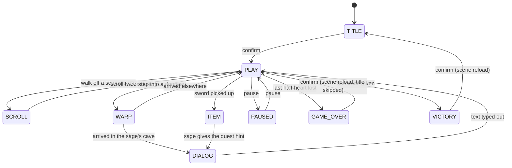
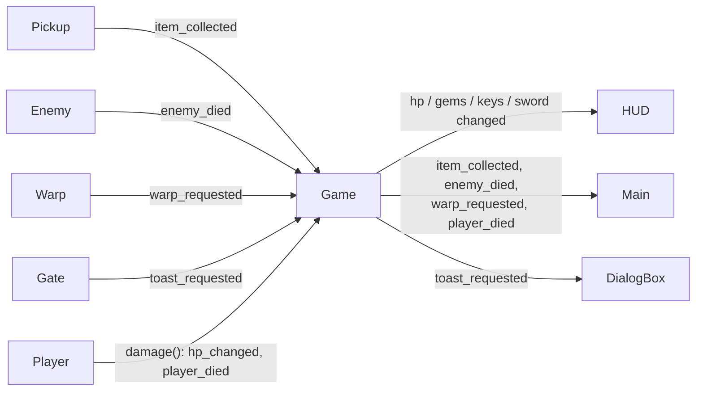
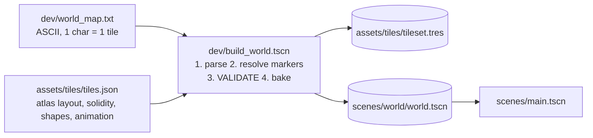

# Glade Quest: architecture and tooling

Glade Quest is a top-down action-adventure proof of concept in Godot 4, in the style of the 8-bit classics. It contains:

- a small overworld (3×3 screens) and one cave
- sword combat, two enemy types, pickups and an NPC
- a key-and-gate puzzle and a win condition

**Every asset is generated by code in this repo.** That covers sprites, tiles, font, logo, sound effects and music, so there are no third-party assets and no licensing questions.

| | |
|---|---|
| **Engine** | Godot **4.6** (tested on 4.6.3 and 4.7.2), GDScript, GL Compatibility renderer |
| **Size** | ~1,370 lines of game GDScript, ~720 lines of dev tooling, ~1,500 lines of Python asset generator |
| **Runtime dependencies** | None beyond Godot. No addons, no C#/.NET |
| **Build-time dependencies** | Python 3.10+ with Pillow and numpy (only to *re*generate assets; outputs are committed) |
| **Tests** | One end-to-end playtest with 37 checks. It plays the whole quest in about 1 s headless and passes on 4.6.3 and 4.7.2 |

---

## 1. Repository structure

```text
.
├── project.godot              Engine config: 256×224 viewport, 3× integer window, input map,
│                              physics layer names, autoloads, GL Compatibility, pixel snapping
├── icon.png                   Generated project icon
├── scenes/
│   ├── main.tscn              Root scene: World + Actors + Camera + HUD/Dialog/Overlay layers
│   ├── world/world.tscn       GENERATED by dev/build_world.tscn (TileMapLayer + objects + spawns)
│   ├── actors/                player.tscn, slime.tscn, spitter.tscn, projectile.tscn
│   ├── objects/               pickup, locked_gate, warp, sage, fire
│   ├── fx/poof.tscn           One-shot smoke puff
│   └── ui/                    hud.tscn, dialog_box.tscn, overlay.tscn
├── scripts/
│   ├── main.gd                Game flow state machine + room logic (camera, scrolling, spawns)
│   ├── autoload/game.gd       Run state + event bus (signals)        autoload "Game"
│   ├── autoload/sound.gd      SFX voice pool + music channel          autoload "Sound"
│   ├── actors/                player.gd, enemy.gd (shared brain), projectile.gd
│   ├── objects/               pickup.gd, locked_gate.gd, warp.gd, npc.gd, fire.gd
│   ├── fx/poof.gd
│   └── ui/                    hud.gd, dialog_box.gd, overlay.gd
├── assets/                    GENERATED by tools/generate_assets.py (+ Godot .import files)
│   ├── sprites/               hero, sword, slime, spitter, rock, sage, fire, items, gate, poof
│   ├── tiles/                 tiles.png atlas, tiles.json manifest, tileset.tres (built by Godot)
│   ├── fonts/                 pixel_font.fnt + .png (BMFont)
│   ├── ui/                    hud.png icons, title_logo.png, theme.tres (default font)
│   └── audio/                 sfx/*.wav (18), music/*.wav (2 looping tracks)
├── dev/                       In-engine tooling (not part of the game)
│   ├── world_map.txt          The world, as ASCII: the single source of truth for the level
│   ├── build_world.gd/.tscn   Validates the map, bakes tileset.tres + world.tscn
│   └── playtest.gd/.tscn      End-to-end automated playtest + screenshot capture
├── tools/                     Python asset pipeline (.gdignore: invisible to Godot)
│   ├── generate_assets.py     Entry point
│   └── assetgen/              palette, pixels, sprites, tiles, font, audio
└── docs/                      (.gdignore)
    ├── ARCHITECTURE.md        This file
    ├── media/                 Screenshots + demo GIF captured by the playtest
    └── review/                Code review of rogerolowski69/game-dev-studio-zelda (+ patches, evidence)
```

**Generated vs hand-written.** `assets/*` (except `theme.tres`), `assets/tiles/tileset.tres`, `scenes/world/world.tscn` and `icon.png` are build outputs. Everything else is hand-written. Outputs are committed, so the project opens and runs without running any tool.

---

## 2. Runtime architecture

### Scene tree



Two autoloads sit outside the scene:
- **`Game`** holds the run state and the event bus.
- **`Sound`** is an 8-voice SFX pool plus one music player.

`Main` runs with `PROCESS_MODE_ALWAYS`, so it can handle the pause key while the tree is paused. `World` and `Actors` are `PAUSABLE`, so pausing freezes gameplay but not the UI.

### Game flow (`scripts/main.gd`)



One `flow` enum gates input and room logic: room-exit checks run only in `PLAY`, and pause works only from `PLAY`. Long sequences (scrolling, warps, fanfares, game over) are written as coroutines (`await tween.finished`, `await get_tree().create_timer(...)`). That keeps each sequence readable top to bottom.

### Event bus (`Game` signals)



Scenes never hold references to `Main`. They emit on `Game`, and `Main` decides what happens: fanfare, victory, key drop, warp. Pickups and gates can therefore be dropped into any scene and just work, and `Main` is the single place that orchestrates the flow.

### Rooms, camera and screen scrolling

- The world is a grid of **16×11-tile rooms** (256×176 px). The viewport is **256×224**: the top 48 px belong to the HUD.
- The camera is a `Camera2D` anchored **top-left** at `room_origin − (0, 48)`, so the HUD always covers the strip above the room.
- Walking past a room edge in the overworld starts an NES-style **scroll**:
  - the camera tweens to the neighbour while the hero walks 22 px in (0.6 s)
  - the old room's actors are frozen during the scroll, then freed
  - the new room's enemies spawn with a smoke puff
- Knockback never triggers a scroll. If a hit pushes the hero past an edge, they are clamped back.
- **Enemies re-spawn on every room entry**, as in the originals. Each enemy is confined to its room's rectangle.
- The **cave** lives at room (4,1), outside the overworld rectangle. It's reachable only through warps, which fade to black, move the hero, snap the camera and switch music.

### Player (`scripts/actors/player.gd`)

| Mechanic | Implementation |
|---|---|
| Movement | `CharacterBody2D` in floating mode, 80 px/s, 8-way input via `Input.get_vector` (analog-ready) |
| Facing | 4-way and "sticky": the current facing is kept while its key is held, so diagonals don't flicker |
| Corner slide | When a cardinal move is blocked, `test_move` probes up to 6 px sideways and nudges the hero round the corner. This is the key game-feel trick for 1-tile gaps |
| Collision box | 10×8 at the feet, so the head can overlap the tile above (classic top-down depth) |
| Sword | Separate `Area2D` hitbox, rotated per facing, active for 0.18 s of a 0.26 s swing. It hits each enemy at most once per swing |
| Damage | Half-heart units, axis-aligned knockback (200 px/s for 0.15 s), 1 s of blinking i-frames |
| Shield | A rock arriving head-on (dot product < −0.7) while not swinging is deflected (`Projectile.deflect()`) |
| Item pose | `hold_up(texture, region)` shows the item overhead. `Main` controls its timing |

### Enemies (`scripts/actors/enemy.gd`)

One script, configured through exports. A small state machine drives it: `SPAWN → WANDER ⇄ PAUSE (→ SHOOT) → HURT → DEAD`.

| | Slime | Spitter |
|---|---|---|
| HP / speed | 2 / 28 px/s | 3 / 34 px/s |
| Behaviour | Random cardinal wandering; 40% chance per turn to step toward the hero | Wanders, then stops, faces the hero (70%) and spits a rock (110 px/s) |
| Sprite | 2-frame squash | 2-frame walk, rotated toward travel (the art faces down) |

Every enemy deals ½-heart contact damage. A hit gives a white flash, knockback, and brief invulnerability (the `HURT` state). On death the enemy plays a puff and rolls for loot: 36% gem, 20% heart, 6% blue gem (worth 5). Loot blinks out after 9 s.

### Quest logic

1. The start room is safe. A toast points to the cave.
2. Entering the cave triggers the sage's typed dialog. Taking the sword plays the item fanfare and the sage's hint.
3. Clearing **all** enemies in the graveyard (room 2,2) drops the key. `Game.key_rooms` remembers it as `dropped` or `taken`, so it reappears if you leave without it.
4. Touching the shrine gate with a key opens it. Without one, you get a toast.
5. Taking the Sunstone triggers the victory fanfare and a stats screen (time, gems, foes).

### Physics layers

| # | Name | On it | Detected by |
|---|---|---|---|
| 1 | world | TileMap solids, gate, sage, fires | player/enemy bodies, rocks |
| 2 | player | hero body | pickups, warps, gate touch area |
| 3 | enemy | enemy bodies | other enemies (no stacking) |
| 4 | player_sword | sword hitbox | — (it detects layer 5) |
| 5 | enemy_hurtbox | enemy hurtboxes | sword, hero hurtbox (contact damage) |
| 6 | enemy_projectile | rocks | hero hurtbox |
| 7 | pickup | pickups | — |
| 8 | trigger | warps, gate touch area | — |

The hero's body does **not** collide with enemies. Contact damage comes from the hurtbox overlap, which avoids the hero getting wedged against monsters.

### UI

- **HUD** (`hud.gd`): drawn by hand in a single `_draw()`. That covers the minimap (visited rooms are lighter; the dot turns gold in the cave), gem and key counters, the "A" item slot, and the hearts (full/half/empty, 8 per row). Hand-drawing keeps every element on exact pixels.
- **DialogBox**: a typewriter with blips. Pressing attack or confirm reveals the full text. `visible_characters_behavior = after shaping`, so words never jump lines while typing. The same box shows toasts.
- **Overlay**: title, pause, game over, victory and the black warp fade. It blinks prompts, and ignores input for a moment on end screens so a mashed button doesn't skip them.

### Audio

- **`Sound.play(&"name")`** goes round-robin over 8 `AudioStreamPlayer` voices, with optional pitch jitter (sword swings vary slightly).
- **Music**: one player per area (`overworld`, `cave`). `duck_music()` dips it under the item fanfare.
- **Looping**: each music WAV carries a RIFF **`smpl` loop chunk**. Godot's importer ("Detect From WAV") then loops it with no code and no import tweaks. The playtest asserts this.

---

## 3. The world pipeline (ASCII map → Godot scene)



Run it with:

```bash
godot --headless --path . res://dev/build_world.tscn
```

**Why a builder instead of hand-painting?** The level is reviewable and diffable text, it's validated mechanically, and **Godot itself serializes** the TileSet and the packed `tile_map_data`, so there's no hand-encoded binary. The output is a normal scene: you can open `world.tscn` and keep painting in the TileMap editor. Note that re-running the builder overwrites hand edits.

**Map legend** (also in the file header):
- Terrain: `.` grass, `"` flowers, `S` sand, `T` tree, `R` rock, `M` cliff, `W` water, `C` cave doorway, `F` stone floor, `X` stone wall, `^` statue, `H` grave, `#` cave wall, `:` cave floor.
- Markers: `P` start, `s`/`o` slime/spitter, `K` key, `G` gate, `*` Sunstone, `N` sage, `f` fire, `w` sword, `A`/`@` warp arrival points, `E` cave exit.
- The tile under a marker is inferred by majority vote of its neighbours.

**Auto-tiling done by the builder:**
- Water picks one of 16 shoreline variants from a 4-bit land-neighbour mask (N=1, E=2, S=4, W=8).
- Cliffs with walkable ground below get a shaded "face" tile.
- Grass, sand and trees get deterministic hash-based variants.

**Validation.** The builder refuses to write a broken world. It checks:
- row widths and room sizes
- exactly one start, sage, sword and so on
- **room seams**: an opening on one side of a room edge must be open on the other side
- the overworld's outer edge has no holes
- **reachability** by flood fill from the start, following warps: the key must be reachable *without* the gate, and every enemy, item and marker must be reachable *with* it

This caught two real seam bugs during development.

Collision shapes are full squares for walls and water, and **chamfered octagons** (3 px cut corners) for trees, rocks, statues and graves, so the hero glides around them.

---

## 4. The asset pipeline (code → pixels and sound)

```bash
python3 tools/generate_assets.py --preview /tmp/preview   # writes assets/ (+ an upscaled contact sheet)
godot --headless --path . --import                       # let Godot (re)import
```

| Module | What it makes | How |
|---|---|---|
| `palette.py` | ~50 named colours | One shared palette keeps art cohesive across sprites and tiles |
| `pixels.py` | helpers | Text grid → RGBA image, sheet packing, mirroring |
| `sprites.py` | hero (10 frames in a 6×2 sheet), sword, slime, spitter, rock, sage, fire, items, gate, poof, HUD icons, icon | **Hand-authored 16×16 text grids**, one character per pixel with a per-sprite legend. Round and radial things (Sunstone, gate, smoke) are drawn procedurally, then auto-outlined |
| `tiles.py` | 18 terrain tiles + 16 water masks × 2 animation frames, `tiles.json` | Procedural: seeded noise tufts, strata, bricks, disc canopies with directional shading; water foam per edge mask |
| `font.py` | 5×7 pixel font as **BMFont** (`.fnt` + `.png`), title logo | Glyph bitmaps in code. Godot imports BMFont natively; ×2 sizes stay crisp. The logo is the font at 3× with a gradient, thick outline and drop shadow |
| `audio.py` | 18 SFX, 2 music loops | numpy synth: **PolyBLEP** band-limited pulse waves (no aliasing), triangle bass, sample-and-hold noise drums, ADSR envelopes, glides and vibrato. A small sequencer renders an original 16-bar overworld theme (132 BPM) and an 8-bar cave theme. Release tails are folded into the loop start for seamless loops. One-shots get 1 ms/6 ms de-click fades |

**Determinism.** Every random choice is seeded, and PNG/WAV writing is stable, so **re-running the generator produces byte-identical files** (verified). Asset diffs in git therefore only appear when the art or sound actually changed.

Formats: PNG (RGBA) and WAV (22.05 kHz, 16-bit mono). On import, Godot 4.6 compresses WAVs (QOA by default), so source simplicity costs nothing at runtime. Total source assets are ~2.9 MB, of which 2.3 MB is the two music loops.

---

## 5. Tool picks and why

| Choice | Why | Alternatives considered |
|---|---|---|
| **Godot 4.6** | Matches the existing studio project; current LTS-like line; `TileMapLayer` (4.3+), typed GDScript, scene format 4. Also verified on 4.7.2 | Unity (heavy for a 2D PoC, licensing churn); Phaser (web only) |
| **GL Compatibility renderer** | 2D pixel art needs nothing from Forward+. Works on old GPUs, enables web export, and renders under Mesa llvmpipe, so CI can take screenshots without a GPU | Forward+ (the default in the existing repo; no benefit here) |
| **Viewport stretch + integer scale + nearest + 2D snapping** | The only combination that keeps every pixel square at any window size | `canvas_items` stretch (mixes resolutions; text stops looking pixel-exact) |
| **GDScript** (statically typed) | No .NET dependency, fastest iteration, and supports web export (C# web export isn't supported in Godot 4) | C# |
| **Event bus on an autoload** | Decouples pickups, enemies and warps from the flow controller | Direct node references (brittle), groups + `call_group` (untyped) |
| **One enemy script + exports** | Two enemy types for the price of one tested brain; new variants are data | Inheritance tree (overkill at this size) |
| **ASCII map + Godot-side builder** | Diffable, validated levels, and the engine writes its own formats | Hand-painted TileMap only (not reviewable or validatable); Tiled + importer addon (extra dependency) |
| **Python + Pillow + numpy for assets** | Art and audio as reviewable code; deterministic; no proprietary tools; trivially scriptable in CI | Aseprite/LMMS (manual, binary sources) |
| **BMFont** | Native Godot import, crisp integer scaling, no TTF needed | Dynamic TTF (blurry at 8 px without care) |
| **WAV + `smpl` loop chunk** | Zero extra encoders; the loop point travels with the file | OGG (needs an encoder, plus `loop = true` in code or import settings) |
| **Headless Godot + `--fixed-fps 60`** for tests | Deterministic, and the full quest runs in ~1 s | GUT/gdUnit4 (good, but an addon dependency for a single E2E test) |
| **Xvfb + Mesa llvmpipe + Movie Maker** | Real rendered screenshots, a GIF and an MP4 from CI-style runs | Manual captures |
| **gdtoolkit (`gdlint`) + ruff** | Lint GDScript and Python. Both are clean (see `gdlintrc`, `ruff.toml`) | — |

---

## 6. Libraries and dependencies

| Scope | Package | Version used | Purpose |
|---|---|---|---|
| Runtime | Godot Engine | 4.6.3 (also 4.7.2) | Everything at runtime. No addons |
| Asset build | Python | 3.13 (3.10+ needed for `X \| Y` types) | Generator |
| Asset build | Pillow | 12.x | Image composition, PNG output |
| Asset build | numpy | 2.x | Audio synthesis |
| Dev (optional) | gdtoolkit | 4.5 | `gdlint scripts dev` |
| Dev (optional) | ruff | 0.16 | `ruff check tools` |
| Dev (optional) | xvfb, Mesa, ffmpeg | distro | Screenshots, GIF/MP4 from the playtest |

---

## 7. Testing

```bash
# Full quest, headless, deterministic (~1 s):
godot --headless --fixed-fps 60 --path . res://dev/playtest.tscn
# Same with screenshots (needs a renderer):
xvfb-run -a godot --rendering-driver opengl3 --fixed-fps 60 --path . res://dev/playtest.tscn -- --shots=/abs/out
```

The playtest drives the real `main.tscn` with simulated input. A driver node parented to the root survives the game's own scene reloads. It asserts 37 checks across:

- **Boot and flow:** title → play, pause/resume, game over → retry skips the title with full health, victory → title with progress reset.
- **Movement and warps:** walks to the cave door, warp + dialog, sword pickup + fanfare + hint, exits the cave and reappears below the door.
- **Screens:** an east-edge scroll lands in the right room with the camera snapped and exactly 4 enemies spawned; south scroll into the graveyard.
- **Combat:** a sword swing damages; a whole room can be cleared; kills are counted; a head-on rock is shield-blocked; a rock from behind costs ½ heart with knockback.
- **Quest:** clearing the graveyard drops the key; the key is collected; the gate spends it; the Sunstone wins.
- **Audio:** music streams import as looping.

Exit code 0 means everything passed. It ran 20/20 green across varying random enemy AI, and passes on Godot 4.6.3 and 4.7.2.

Suggested CI job: download Godot (4.6.x), run `--import` twice (the first pass on a fresh clone reports not-yet-imported resources, which is normal), run the builder (to confirm the committed world still validates), then the playtest.

---

## 8. Extending the PoC

| Want to… | Do this |
|---|---|
| Change the level | Edit `dev/world_map.txt`, run the builder. The validator explains any problem by room and tile |
| Grow the overworld | Widen the map, then update `OVERWORLD` in `scripts/main.gd`, `OVERWORLD_ROOMS` in `dev/build_world.gd` and `MAP_ROOMS` in `scripts/ui/hud.gd` |
| Add an enemy type | New scene reusing `enemy.gd` (tune the exports), register it in `ENEMY_SCENES` in `main.gd`, and add a map marker in `build_world.gd` |
| Add an item | New `Pickup.Kind` + a frame in `items.png` (`sprites.py`) + handling in `pickup.gd` / `main.gd` |
| Restyle the art | Edit the grids in `tools/assetgen/sprites.py` or the palette, and re-run the generator. `--preview` writes a contact sheet |
| New music | Edit the note lists in `tools/assetgen/audio.py` (`OVERWORLD`, `CAVE`) |
| NFT-gated zone (your TON prototype) | `locked_gate.gd` is the hook. Swap `Game.use_key()` for a wallet ownership check, but address the bridge issues in `docs/review/` first |

---

## 9. Known limitations and next steps

- **Scope:** no save system, no dungeons, bushes, bombs or shops, one key and gate, simple AI. The architecture is built to grow (data-driven enemies, map builder, event bus).
- **Godot 4.6+ only:** `world.tscn` is written by 4.6 in scene format 4. Rebuilding the world changes Godot's per-node `unique_id`s, so rebuild diffs are noisier than the actual change.
- **Exports:** `dev/` is in-engine tooling. Add `dev/*` to the export preset's exclude filter.
- **First import:** on a fresh clone, Godot may log "resource not found" for the theme and audio while it imports for the first time. They disappear once the import finishes.
- **Exit warning in headless runs:** Godot reports `ObjectDB instances leaked at exit` if audio is playing when a headless/dummy-audio process quits. This was reproduced in a minimal one-node project on both 4.6.3 and 4.7.2. It's an engine shutdown quirk, not a game leak.
