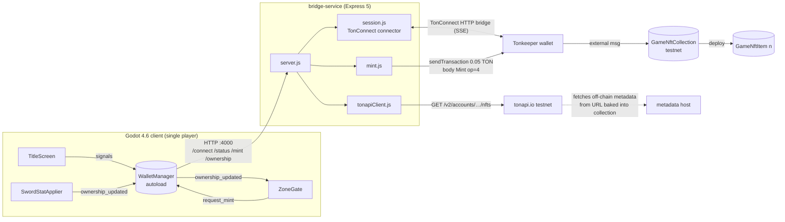
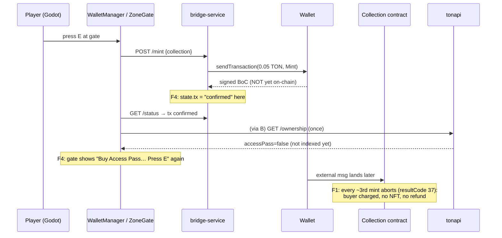

# Code review: `rogerolowski69/game-dev-studio-zelda`

| | |
|---|---|
| **Reviewed commit** | [`0784c68`](https://github.com/rogerolowski69/game-dev-studio-zelda/commit/0784c68a6d3bff11098ce5302b081b68f51e2b2f) (`master`, 2026-07-31), 4 commits, 55 tracked files, ~600 KB |
| **Scope** | Everything: Godot game, Node bridge service, Tact contracts and tests, deploy scripts, design spec |
| **Method** | Read every file, then **ran** each layer to check the suspicious parts: Godot 4.6.3 headless with scripted input, the contracts in `@ton/sandbox`, and the bridge probed live over HTTP. Every finding marked ✅ was reproduced. The commands to rerun them are in [§8](#8-reproducing-the-evidence). |
| **Fix patches** | [`patches/0001-…godot….patch`](patches/0001-godot-fix-camera-feedback-sword-facing-enemy-material.patch) and [`patches/0002-…mint-accounting.patch`](patches/0002-contracts-fix-mint-accounting.patch). Both `git apply` cleanly on `0784c68` and both are re-verified. |

---

## 1. Verdict

**The architecture choices are good, but the project isn't shippable yet, even on testnet.** It has three blocking problems:

1. **The mint contract keeps buyers' money without minting.** `Mint` pays the 0.02 TON item deposit out of the collection's own reserve. The reserve drains in two mints, and then **every third buyer is charged 0.05 TON, gets no NFT, and gets no refund** (measured; see [F1](#f1--critical-mint-drains-the-collection-reserve-every-3rd-buyer-pays-for-nothing-)). On mainnet this would lose customers' funds.
2. **The core game loop is broken.**
   - Holding W makes the player's facing (and the attached camera) flip ±30° *every physics frame*, and the player walks ~45° off-course.
   - The sword hitbox sits **behind** the player, so you can't hit the enemy you walk up to.

   It looks like the game was never playtested.
3. **Purchase confirmation is wrong.** The bridge reports `confirmed` as soon as the wallet *signs*, not when the NFT exists on-chain. The single ownership refetch then misses the NFT, and the gate **offers the purchase again**. Separately, any `/ownership` failure (for example a tonapi rate-limit) **leaves the title-screen gate stuck forever**.

What's done well:
- The wallet cryptography lives in a Node bridge that uses the official TonConnect SDK, so none of it is hand-rolled in GDScript. That was the right call.
- The contracts start from the Tact TEP-62 reference NFT and have sandbox tests (16/16 pass).
- The spec is clear and scoped to testnet.
- The Godot code is small, readable and signal-driven.

The defects are fixable. The dangerous ones are in the money path, and the existing tests didn't catch them because no test checks a balance or a confirmation.

| Area | State | One-liner |
|---|---|---|
| Tact contracts | 🔴 | Reference-quality item contract; the custom `Mint` has a critical accounting bug |
| Bridge service | 🟠 | Clean and small, but unauthenticated on every interface, "confirmed" means "signed", no tx timeout |
| Godot wallet flow | 🟠 | Good signal design, but dead-ends on errors, can prompt a second payment, and the sword purchase is not wired |
| Godot gameplay | 🔴 | Movement feedback loop, inverted sword, shared enemy material |
| Tests | 🟡 | Contract unit tests are fine but miss invariants. Bridge and Godot have none |
| Docs/spec | 🟢 | Good spec and README. One wrong instruction (localhost metadata) |

---

## 2. Repo map

```text
game-dev-studio-zelda/                         Godot project at the repo root (runs with Godot 4.6)
├── project.godot                              4.6 · Forward+ · main scene = TitleScreen · autoload WalletManager
│                                              input: WASD move, Space jump, LMB attack, E interact, Esc mouse toggle
├── scenes/
│   ├── TitleScreen.tscn                       wallet hard gate: status / Connect / link / Open-in-wallet / error / Retry
│   ├── Main.tscn                              40×40 m ground, sun, procedural sky, Player, Enemy×2, HUD, ZoneGate, SwordStatApplier
│   ├── Player.tscn                            CharacterBody3D capsule → CameraPivot → SpringArm3D → Camera3D; SwordHitbox (Area3D)
│   ├── Enemy.tscn                             CharacterBody3D red box (shared StandardMaterial3D)
│   ├── HUD.tscn                               CanvasLayer: HP ProgressBar + Label
│   └── ZoneGate.tscn                          Area3D detect (r=4.5) + StaticBody3D barrier (r=2.5) + glowing torus + Label3D prompt
├── scripts/
│   ├── Player.gd          122 LOC             third-person move/jump, melee window, health, respawn
│   ├── Enemy.gd            95 LOC             chase-and-hit AI, hit flash, respawn after 2 s
│   ├── HUD.gd              15 LOC             binds to Player.health_changed
│   ├── WalletManager.gd   155 LOC  (autoload) HTTP client for the bridge, 1.5 s /status poll, ownership cache, mint requests
│   ├── TitleScreen.gd      54 LOC             connect UI → change_scene(Main) on first ownership_updated
│   ├── ZoneGate.gd         64 LOC             barrier off iff has_access_pass; E → request_mint("zoneAccessPass")
│   ├── SwordStatApplier.gd 27 LOC             Player.attack_damage ← sword NFT metadata (falls back to base)
│   └── *.gd.uid                               Godot ≥4.4 script UIDs (correctly committed)
├── bridge-service/                            Node ≥22 (uses --env-file-if-exists), ESM
│   ├── package.json                           express ^5.2.1 · @tonconnect/sdk ^4.0.0 · @ton/core ^0.63.1
│   ├── src/server.js                          POST /connect · GET /status · POST /mint · GET /ownership · static public/
│   ├── src/session.js                         one TonConnect connector (in-memory storage, testnet), one global state object
│   ├── src/mint.js                            Mint{op=4,queryId} payload → connector.sendTransaction(0.05 TON)
│   ├── src/tonapiClient.js                    tonapi GET /v2/accounts/{addr}/nfts?collection=… → accessPass, sword.attackDamage
│   ├── src/config.js                          env → config (PORT, manifest URL, tonapi URL, collections, price, validity)
│   └── public/                                tonconnect-manifest.json + metadata/{zone-access-pass,legendary-sword}/*.json
├── ton-contracts/                             Tact 1.6.13 · Blueprint 0.45 · @ton/sandbox 0.44 · jest 29 + ts-jest
│   ├── contracts/GameNftCollection.tact       TEP-62 collection + custom public payable Mint (the only bespoke logic)
│   ├── contracts/GameNftItem.tact             TEP-62 item (Tact reference implementation, contract-parameters syntax)
│   ├── contracts/{messages,constants}.tact    TL-B messages, opcodes, exit codes, MintPrice=0.05, ItemDeployAmount=0.02
│   ├── scripts/deploy{ZoneAccessPass,LegendarySword}.ts   interactive Blueprint deploy (TonConnect), funds collection 0.05 TON
│   ├── tests/GameNftCollection.spec.ts        9 tests ┐ 16/16 pass
│   ├── tests/GameNftItem.spec.ts              7 tests ┘
│   └── metadata/                              same JSON as bridge-service/public/metadata (duplicated)
└── docs/superpowers/specs/2026-07-28-ton-nft-gated-zone-design.md   design spec (approved)
```

### Runtime architecture



### Purchase flow, annotated with the defects



---

## 3. Stack and library picks

| Layer | Pick | Version (lockfile) | Assessment |
|---|---|---|---|
| Engine | Godot, GDScript, Forward+ renderer | 4.6 | Fine. A 2D top-down Zelda would use `gl_compatibility` for web export and broader GPU support, but this prototype is 3D |
| Wallet protocol | `@tonconnect/sdk` (official) | 4.0.0 | ✅ Right call. Keeps protocol crypto out of GDScript. Polyfills `EventSource`/`fetch` itself, so it works under Node. `setConnectionNetwork` is a real v4 API and aborts wrong-network connects |
| HTTP | Express | 5.2.x | Fine. Express 5's `req.body` is undefined without a parser, and that's handled correctly (`req.body ?? {}`) |
| Cell building | `@ton/core` | 0.63.x | Fine |
| Contracts | Tact + Blueprint + Sandbox + jest | 1.6.13 / 0.45 / 0.44 / 29 | ✅ Good toolchain. `npm run build` (`blueprint build`) is **interactive** (it prompts for a contract), so CI needs `blueprint build --all` or `tact --config tact.config.json` |
| Indexer | tonapi.io v2 (testnet), keyless | n/a | Workable. Keyless requests are rate-limited, the client has no API-key support, and it ignores the `verified` flag (see F10) |
| Metadata | Off-chain JSON served by the bridge | n/a | ⚠️ Must be **publicly reachable and stable**, because tonapi fetches it and the URL is immutable in the collection (see F9) |

---

## 4. Findings summary

Severity: 🔴 critical · 🟠 high · 🟡 medium · ⚪ low. ✅ means reproduced by running code. 📖 means found by inspection.

| # | Sev | Area | Finding | How confirmed | Fix |
|---|---|---|---|---|---|
| F1 | 🔴 | contracts | `Mint` funds item deposits from the collection reserve. Every 3rd buyer pays and gets nothing | ✅ sandbox | patch 0002 ✅ |
| F2 | 🟠 | gameplay | Camera rig inherits the body's yaw, causing a feedback loop: ±30°/frame jitter and 45° drift | ✅ headless | patch 0001 ✅ |
| F3 | 🟠 | gameplay | Body faces +Z but the sword hitbox is at −Z, so it hits behind the player | ✅ headless | patch 0001 ✅ |
| F4 | 🟠 | wallet | "confirmed" means the wallet signed; ownership is refetched only once, so the gate re-offers the purchase | ✅ mock bridge | §5 sketch |
| F5 | 🟠 | wallet | One `/ownership` failure leaves the title gate stuck forever (no retry, no error) | ✅ mock bridge | §5 sketch |
| F6 | 🟡 | bridge sec | Listens on all interfaces, no auth, no Host check. README's `ngrok http 4000` publishes the control API to the internet | ✅ live probe | §5 sketch |
| F7 | 🟡 | bridge | No tx timeout: a never-answered request blocks all future mints. `statusPollTimeoutMs` is unused | 📖 | §6 |
| F8 | 🟡 | wallet | Stale `tx` from the previous mint can resolve a new mint (no request id) | 📖 race | §6 |
| F9 | 🟡 | deploy | Metadata URL must be public and is immutable. README's localhost option can't work with tonapi | 📖 | §6 |
| F10 | 🟡 | bridge sec | Ownership ignores tonapi `verified` | 📖 + OpenAPI | §6 |
| F11 | 🟡 | wallet | Cached ownership never resets on disconnect or wallet switch | 📖 | §6 |
| F12 | 🟡 | feature | Buying the sword isn't wired in Godot. The sword "on-chain stat" is mutable off-chain JSON | 📖 | §6 |
| F13 | ⚪ | gameplay | Enemies share one material, so hitting one flashes all | ✅ headless | patch 0001 ✅ |
| F14 | ⚪ | misc | ERR_BUSY reported as "bridge unreachable", `_minting` can stick, double `_die()`, order-dependent group, … | 📖 | §7 |

---

## 5. Critical and high findings in detail

### F1 · 🔴 `Mint` drains the collection reserve: every ~3rd buyer pays for nothing ✅

**Where:** [`ton-contracts/contracts/GameNftCollection.tact:32-53`](https://github.com/rogerolowski69/game-dev-studio-zelda/blob/0784c68a6d3bff11098ce5302b081b68f51e2b2f/ton-contracts/contracts/GameNftCollection.tact#L32-L53)

The comment at lines 42-45 is wrong. It says the sweep sends "MintPrice minus the item's deploy reserve" and "never [touches] the collection's own storage balance". In fact, `SendRemainingValue` (mode 64) forwards *the inbound value minus gas*. It does **not** subtract value already sent by earlier actions in the same transaction. So:

- The 0.02 TON item deposit plus its forwarding fee is paid from the **collection's own balance**.
- The owner receives roughly the full 0.05 TON.
- The collection loses 0.0205 TON per mint.

Once the reserve can't cover a deposit, the **action phase fails with resultCode 37 and the transaction aborts**. Action-phase failures don't bounce here, so the buyer's 0.05 TON stays in the collection: no NFT, no refund. That captured payment refills the reserve for the next two mints, and the cycle repeats.

**Measured** in `@ton/sandbox`, collection funded with 0.05 TON exactly like `scripts/deploy*.ts`:

```text
after deploy: collection balance = 0.049692932 TON
mint #0: ok      collection 0.049692932 → 0.029189264 (−0.0205)  owner +0.049245931  buyer −0.050311002  nextItemIndex=1
mint #1: ok      collection 0.029189264 → 0.008685596 (−0.0205)  owner +0.049245931  buyer −0.050311002  nextItemIndex=2
mint #2: ABORTED action phase resultCode=37  collection → 0.058023796 (+0.0493)  owner +0  buyer −0.050311002  nextItemIndex=2   ← paid, no NFT
mint #3: ok      … (funded by mint #2's swallowed payment)

10 buyers, ORIGINAL : minted 7/10 · charged with NO NFT: 3 · refunds: 0 · owner +0.3447 TON
10 buyers, PATCHED  : minted 10/10 · charged with NO NFT: 0 · collection pinned at 0.050 TON · owner +0.2868 TON
```

(The owner earns less under the patch because the item deposit now comes out of the buyer's payment, which is what the original comment intended.)

**Fix ([patch 0002](patches/0002-contracts-fix-mint-accounting.patch), verified):**

```tact
deploy(DeployParameters {
    value: ItemDeployAmount,
    body: initNFTBody,
    init: StateInit { code: self.commonCode, data: self.commonData.storeUint(itemIndex, 64).endCell() },
    mode: SendPayFwdFeesSeparately | SendBounceIfActionFail,   // can't pay → bounce to buyer, never swallow
});
nativeReserve(minTonsForStorage, ReserveAtMost);              // keep a fixed floor, never fails
message(MessageParameters {
    bounce: false, to: self.owner, value: 0, body: beginCell().endCell(),
    mode: SendRemainingBalance | SendIgnoreErrors,             // sweep the rest; a failed sweep can't abort the mint
});
```

The patch also adds a regression test, `keeps the collection balance stable and mints for every buyer`. It **fails on the original contract and passes on the fix**, and the full existing suite stays green (10/10 collection tests).

Side effect: anything above the 0.05 TON floor (for example a top-up) is swept to the owner on the next mint. That also covers the missing withdraw function.

Two related notes, by inspection:
- Overpaying is swept to the owner with no refund (measured: a buyer sending 1 TON loses 1.0003 TON). Consider refunding `ctx.value - MintPrice`.
- `MintPrice` is a contract constant, but the bridge price is the env var `MINT_PRICE_NANOTON` ([`config.js:20`](https://github.com/rogerolowski69/game-dev-studio-zelda/blob/0784c68a6d3bff11098ce5302b081b68f51e2b2f/bridge-service/src/config.js#L20)), and the UI hardcodes "0.05 TON" ([`ZoneGate.gd:61`](https://github.com/rogerolowski69/game-dev-studio-zelda/blob/0784c68a6d3bff11098ce5302b081b68f51e2b2f/scripts/ZoneGate.gd#L61)). Expose a `get fun mint_price()` getter and read it from there.

### F2 · 🟠 Movement feedback loop: yaw jitters ±30° every frame and the player drifts 45° ✅

**Where:** [`scenes/Player.tscn:30`](https://github.com/rogerolowski69/game-dev-studio-zelda/blob/0784c68a6d3bff11098ce5302b081b68f51e2b2f/scenes/Player.tscn#L30) (`CameraPivot` is a child of the rotating body) and [`scripts/Player.gd:58-68`](https://github.com/rogerolowski69/game-dev-studio-zelda/blob/0784c68a6d3bff11098ce5302b081b68f51e2b2f/scripts/Player.gd#L58-L68)

The movement direction is computed from `camera_pivot.global_transform.basis`, and that basis includes the body's yaw. The body then rotates toward the movement direction. For W, the target is always `yaw + π`, so the turn direction is decided by floating-point rounding in `lerp_angle` and flips every frame. The camera is parented to the body, so it **shakes ±30° per frame**, and the averaged velocity points 45° away from the input.

**Measured** (Godot 4.6.3 headless, W held for 2 s from `(0, 5)`):

```text
as authored : yaw samples −60°, −30°, −60°, −60°, −30° …   end (6.94, −2.03): 45° off-axis
with fix    : yaw −180° steady                            (0, 15) → (0, 4.92): 10.08 m dead straight
```

**Fix ([patch 0001](patches/0001-godot-fix-camera-feedback-sword-facing-enemy-material.patch), verified):** set `camera_pivot.top_level = true` in `_ready()` and move it to `global_position + offset` after `move_and_slide()`. Alternatively, rotate only a visual child mesh and never the `CharacterBody3D` itself.

### F3 · 🟠 The sword hits behind you ✅

**Where:** [`scripts/Player.gd:67`](https://github.com/rogerolowski69/game-dev-studio-zelda/blob/0784c68a6d3bff11098ce5302b081b68f51e2b2f/scripts/Player.gd#L67) and [`scenes/Player.tscn:40`](https://github.com/rogerolowski69/game-dev-studio-zelda/blob/0784c68a6d3bff11098ce5302b081b68f51e2b2f/scenes/Player.tscn#L40)

`rotation.y = atan2(dir.x, dir.z)` points the body's **+Z** along the movement, but Godot's forward is **−Z**, which is where `SwordHitbox` sits (`z = −1`).

**Measured:** walk up to an enemy and swing. The dot product between the sword offset and the direction to the enemy is **−1.00**. The enemy in front stays at 3 → 3 HP, while an enemy placed behind drops 3 → 2. With the patch: dot = +1.00, the enemy in front drops 3 → 2, and nothing behind is hit.

**Fix:** use `atan2(-dir.x, -dir.z)`. Patch 0001 also applies it to [`Enemy.gd:69`](https://github.com/rogerolowski69/game-dev-studio-zelda/blob/0784c68a6d3bff11098ce5302b081b68f51e2b2f/scripts/Enemy.gd#L69) for consistency.

### F4 · 🟠 "confirmed" means *signed*, so the player is invited to pay twice ✅

**Where:**
- [`bridge-service/src/mint.js:49-51`](https://github.com/rogerolowski69/game-dev-studio-zelda/blob/0784c68a6d3bff11098ce5302b081b68f51e2b2f/bridge-service/src/mint.js#L49-L51): `connector.sendTransaction` resolves with the signed BoC. The SDK docs say it "returns signed transaction boc that allows you to find the transaction in the blockchain", not that the transaction was executed.
- [`scripts/WalletManager.gd:97-102`](https://github.com/rogerolowski69/game-dev-studio-zelda/blob/0784c68a6d3bff11098ce5302b081b68f51e2b2f/scripts/WalletManager.gd#L97-L102) refetches ownership exactly once.
- [`scripts/ZoneGate.gd:45-48, 59-64`](https://github.com/rogerolowski69/game-dev-studio-zelda/blob/0784c68a6d3bff11098ce5302b081b68f51e2b2f/scripts/ZoneGate.gd#L45-L64) clears `_minting` and re-shows the purchase prompt.

**Measured** with a mock bridge that behaves like the real one while tonapi hasn't indexed the new NFT yet:

```text
step0  at gate:               prompt='Buy Access Pass (0.05 TON) | Press E'  barrier on
step1  6 s after paying:      prompt='Buy Access Pass (0.05 TON) | Press E'  visible, minting=false,
                              barrier on, has_access_pass=false   (/ownership called once, never again)
```

**Fix sketch:**
- Treat the BoC as **`submitted`**.
- Confirm by watching the chain:
  - simplest: poll ownership with backoff until the NFT count increases (cap ~120 s), or
  - more precise: look up the external message hash (tonapi `GET /v2/blockchain/messages/{msg_id}/transaction`) and follow its trace to the collection's internal transaction.
- Keep the gate in a "Waiting for confirmation…" state and **block re-purchase** until the result is confirmed, failed or timed out.

```js
// mint.js
.then(async ({ boc }) => {
  state.tx = { id, collection: key, status: 'submitted', boc, error: null };
  const before = countOwned(key);                       // captured before sendTransaction
  for (const t0 = Date.now(); Date.now() - t0 < 120_000; await sleep(4000)) {
    if ((await countOwnedNow(state.address, key)) > before) { state.tx.status = 'confirmed'; return; }
  }
  state.tx = { ...state.tx, status: 'timeout', error: 'Submitted, not seen on-chain after 2 min. Check your wallet.' };
})
```

### F5 · 🟠 The title-screen hard gate dead-ends on any `/ownership` failure ✅

**Where:** [`scripts/WalletManager.gd:89-91`](https://github.com/rogerolowski69/game-dev-studio-zelda/blob/0784c68a6d3bff11098ce5302b081b68f51e2b2f/scripts/WalletManager.gd#L89-L91) sets `_ownership_fetched_for_session = true` *before* the fetch succeeds. [`:112-114`](https://github.com/rogerolowski69/game-dev-studio-zelda/blob/0784c68a6d3bff11098ce5302b081b68f51e2b2f/scripts/WalletManager.gd#L112-L114) returns silently on failure. TitleScreen only advances on `ownership_updated`.

Keyless tonapi rate-limiting is enough to trigger this: the bridge turns tonapi's error into a 502.

**Measured** (mock bridge returns 502 for `/ownership`):

```text
9 s after Connect: status='Connected! Checking NFT ownership...'  error_visible=false  retry_visible=false  still on title
bridge hits: POST /connect 1 · GET /status 5 · GET /ownership 1   ← never retried
```

This also contradicts the spec's "retry with backoff, surface a user-facing error after repeated failures".

**Fix sketch:**

```gdscript
signal ownership_failed(message: String)
var _ownership_attempts := 0

func fetch_ownership() -> void:
	...
	if json == null:
		_ownership_attempts += 1
		if _ownership_attempts >= 4:
			ownership_failed.emit("Couldn't check NFT ownership (indexer unavailable).")
		else:
			await get_tree().create_timer(pow(2.0, _ownership_attempts)).timeout
			fetch_ownership()
		return
	_ownership_attempts = 0
	...
```

TitleScreen should connect `ownership_failed` to show the error and Retry. Also add `TONAPI_KEY` support (`Authorization: Bearer …`) in `tonapiClient.js`.

---

## 6. Medium findings

**F6 · 🟡 The bridge control API is exposed** ✅. [`server.js:56`](https://github.com/rogerolowski69/game-dev-studio-zelda/blob/0784c68a6d3bff11098ce5302b081b68f51e2b2f/bridge-service/src/server.js#L56) calls `app.listen(port)` with no host, which binds **every interface**. The startup log claims `localhost` anyway. Live probe:
- `GET /status` via the non-loopback IP returns 200.
- A spoofed `Host: attacker.example:4000` returns 200 (the precondition for DNS rebinding).
- A LAN peer's JSON `POST /mint` reaches the mint logic.
- Classic browser CSRF *is* blocked, but only incidentally: `express.json()` ignores `text/plain`, and the preflight gets no CORS headers.

Impact:
- No funds can be stolen: destination and amount are fixed.
- A LAN peer, or a web page via DNS rebinding, can read the wallet address and the pending universal link.
- They can **hijack the connection** by approving the link with their own wallet first.
- They can spam 0.05 TON mint prompts into the user's wallet.
- **The README's `ngrok http 4000` publishes all of this to the internet**, not just the manifest.
- Chrome's Local Network Access prompts reduce the browser vector. LAN and tunnel exposure remain.

**Fix:**
- `app.listen(port, '127.0.0.1')`.
- Serve `public/` from a separate static host or port, and tunnel only that.
- Add API middleware that:
  - allows only `Host` ∈ {`127.0.0.1:PORT`, `localhost:PORT`},
  - rejects any request with an `Origin` header (Godot's `HTTPRequest` sends none),
  - requires a per-launch bearer token shared with Godot (env var or a token file the game reads).

**F7 · 🟡 No transaction timeout.** [`mint.js:30-32`](https://github.com/rogerolowski69/game-dev-studio-zelda/blob/0784c68a6d3bff11098ce5302b081b68f51e2b2f/bridge-service/src/mint.js#L30-L32) refuses new mints while `status === 'pending'`. If the wallet never answers (app closed, request lost), `pending` lasts until the bridge restarts. `config.statusPollTimeoutMs` ([`config.js:22`](https://github.com/rogerolowski69/game-dev-studio-zelda/blob/0784c68a6d3bff11098ce5302b081b68f51e2b2f/bridge-service/src/config.js#L22)) is defined and never used. **Fix:** SDK v4 accepts an abort signal: `connector.sendTransaction(tx, { signal: AbortSignal.timeout(config.mintValiditySeconds * 1000) })`. Map the abort to `expired`, and surface "still pending, check your wallet" per the spec.

**F8 · 🟡 A stale transaction state can resolve a new mint.** `request_mint` sets `_pending_mint_collection` before the bridge has replaced `state.tx`. A `/status` poll in that window returns the *previous* mint's `rejected`/`error` for the same collection. The client then stops tracking the new mint, which the user may still approve and pay for ([`WalletManager.gd:93-102`](https://github.com/rogerolowski69/game-dev-studio-zelda/blob/0784c68a6d3bff11098ce5302b081b68f51e2b2f/scripts/WalletManager.gd#L93-L102), [`mint.js:34`](https://github.com/rogerolowski69/game-dev-studio-zelda/blob/0784c68a6d3bff11098ce5302b081b68f51e2b2f/bridge-service/src/mint.js#L34)). **Fix:** `POST /mint` returns a `mintId`, `state.tx` carries it, and the client matches on it.

**F9 · 🟡 The metadata host must be public and is permanent.**
- tonapi's servers fetch the URL stored in the collection content. The README's "`http://localhost:4000/metadata/…` for same-machine testing" ([`bridge-service/README.md:62-66`](https://github.com/rogerolowski69/game-dev-studio-zelda/blob/0784c68a6d3bff11098ce5302b081b68f51e2b2f/bridge-service/README.md#L62-L66)) therefore resolves to *tonapi's own machine*. The sword's `attackDamage` comes back `null` and the stat never applies.
- The collection has no content-update message, so the URL is **immutable**. A free ngrok URL that changes on restart permanently breaks every item's metadata.

**Fix:** host metadata at a stable HTTPS URL (GitHub Pages, IPFS, S3) *before* deploying, or add an owner-only `ChangeContent`. Already-deployed collections need a redeploy. Also deduplicate `ton-contracts/metadata` and `bridge-service/public/metadata`.

**F10 · 🟡 Ownership doesn't require `verified`.** [`tonapiClient.js:31-45`](https://github.com/rogerolowski69/game-dev-studio-zelda/blob/0784c68a6d3bff11098ce5302b081b68f51e2b2f/bridge-service/src/tonapiClient.js#L31-L45) counts any item tonapi associates with the collection. tonapi's `NftItem.verified` is defined as "*Collection master contract confirmed that this item is part of collection*". Filtering on `item.verified === true` closes the self-deployed-fake-item vector at no cost. I couldn't deploy a forged item on testnet to prove the vector is exploitable through tonapi's `collection` filter, so treat this as hardening.

**F11 · 🟡 The ownership cache never resets.** `_ownership_fetched_for_session` ([`WalletManager.gd:23`](https://github.com/rogerolowski69/game-dev-studio-zelda/blob/0784c68a6d3bff11098ce5302b081b68f51e2b2f/scripts/WalletManager.gd#L23)) and `has_access_pass` survive a disconnect or reconnect with a *different* address. The old wallet's pass keeps the gate open. **Fix:** reset both whenever `address` changes or the status leaves `connected`.

**F12 · 🟡 Spec gaps.**
- There's no in-game way to buy the Legendary Sword. Only `ZoneGate` calls `request_mint`, so `SwordStatApplier` only works for swords minted elsewhere.
- The spec calls the sword's damage an "on-chain stat value", but it's **mutable off-chain JSON** served by whoever hosts it. It's also an absolute `3`, not "3× base".
- There's no QR code on the title screen. The spec asks for a QR panel, and desktop-to-phone wallet flows need one.
- The 2-minute pending timeout and backoff from the spec aren't implemented (F5, F7).

---

## 7. Low findings and nits

- **F13 Shared enemy material** ✅: [`Enemy.gd:13`](https://github.com/rogerolowski69/game-dev-studio-zelda/blob/0784c68a6d3bff11098ce5302b081b68f51e2b2f/scripts/Enemy.gd#L13) uses the scene's sub-resource directly, so hitting one enemy flashes all of them. Measured: same instance; Enemy2 turns white. Fixed in patch 0001 (`duplicate()`). Setting `resource_local_to_scene = true` would also work.
- **`ERR_BUSY` reads as "bridge unreachable"**: an overlapping `/status` or `/ownership` request shows a false error ([`WalletManager.gd:68-71, 107-110`](https://github.com/rogerolowski69/game-dev-studio-zelda/blob/0784c68a6d3bff11098ce5302b081b68f51e2b2f/scripts/WalletManager.gd#L68-L71)). Skip the poll if the request is busy.
- **`ZoneGate._minting` can stick at `true`**: if `request_mint` returns early (another mint pending, or `request()` failed), no `mint_status_changed` fires for this gate ([`ZoneGate.gd:20-23`](https://github.com/rogerolowski69/game-dev-studio-zelda/blob/0784c68a6d3bff11098ce5302b081b68f51e2b2f/scripts/ZoneGate.gd#L20-L23)).
- **Double death**: `Enemy.take_damage` has no dead-guard, so two hits in one frame start two respawn coroutines. Fixed in patch 0001.
- **Order-dependent `player` group**: the group is added in `Player._ready()`, and Enemy, HUD and SwordStatApplier look it up in *their* `_ready()`. It works only because Player comes first in `Main.tscn`. Put `groups=["player"]` in `Player.tscn` instead.
- **`OS.shell_open(universal_link)`** with no scheme check ([`TitleScreen.gd:31-33`](https://github.com/rogerolowski69/game-dev-studio-zelda/blob/0784c68a6d3bff11098ce5302b081b68f51e2b2f/scripts/TitleScreen.gd#L31-L33)). Allow only `https://` and `tc://`.
- **Gating is client-side only.** Anyone can run a fake bridge returning `accessPass: true`. That's fine for a testnet single-player demo. For anything valuable, the content must come from a server that verifies a TonConnect **`ton_proof`** and ownership itself.
- **Contracts**:
  - `ChangeOwner` is single-step, so a typo bricks admin and redirects proceeds. Use two-step accept.
  - No withdraw function (patch 0002's floor sweep covers this).
  - Tests don't assert on balances (that would have caught F1), item owner, metadata URL, or `BatchDeploy`.
- **Config nits**:
  - `required()` has a fallback and can never throw.
  - `import 'node:process'` is a no-op.
  - There's no `"engines"` field, although `--env-file-if-exists` needs a recent Node 22.
- **Repo hygiene**:
  - `.gitignore` excludes `export_presets.cfg`. It's normally committed unless it holds secrets.
  - Debug `print`s are left in `Enemy.gd`.
  - There's no root README.
- **Product risk, not a bug**: a mandatory wallet connection *before any gameplay* will cost most players at the door. Consider "play first, connect to unlock the zone". The spec explicitly chose the hard gate, so this is a deliberate trade-off to revisit.

---

## 8. Reproducing the evidence

Everything I ran is in [`evidence/`](evidence/). Toolchain: Godot 4.6.3 official Linux build, Node 22.22, and the lockfile versions of all npm deps.

```bash
# Contracts: economics probes (original vs patched)
cd ton-contracts && npm ci
cp <this-repo>/docs/review/evidence/ton-contracts/tests/*.spec.ts tests/
cp -r <this-repo>/docs/review/evidence/ton-contracts/contracts_fixed <this-repo>/docs/review/evidence/ton-contracts/tact.fixed.config.json .
npx tact --config tact.config.json && npx tact --config tact.fixed.config.json
npx jest tests/ReviewProbe.spec.ts tests/ReviewProbeFixed.spec.ts

# Godot: gameplay harness (no wallet needed: instantiates Main.tscn directly)
cp -r <this-repo>/docs/review/evidence/godot/review_test .
godot --headless --audio-driver Dummy --path . --import
godot --headless --audio-driver Dummy --path . res://review_test/test_gameplay.tscn

# Godot: wallet flows against the mock bridge (port 4000)
python3 <this-repo>/docs/review/evidence/mock_bridge.py ownership_502 /tmp/hits.json &
godot --headless --audio-driver Dummy --path . res://review_test/test_wallet.tscn -- title
kill %1; python3 <this-repo>/docs/review/evidence/mock_bridge.py indexer_lag /tmp/hits.json &
godot --headless --audio-driver Dummy --path . res://review_test/test_wallet.tscn -- gate

# Apply the fixes
git apply <this-repo>/docs/review/patches/0001-godot-fix-camera-feedback-sword-facing-enemy-material.patch
git apply <this-repo>/docs/review/patches/0002-contracts-fix-mint-accounting.patch
```

## 9. Recommended order of work

1. **Patch 0002 before any further deploy, testnet included.** Redeploy both collections, with metadata on a stable public HTTPS host (F9).
2. **Patch 0001**, then actually play it for 10 minutes.
3. **F4 + F5**: submitted/confirmed semantics, ownership polling with backoff, and an error/retry path on the title screen.
4. **F6 + F7**: bind to loopback, add the token and Host checks, separate the static host, add the tx timeout.
5. F8 to F12, then the nits.
6. Add tests for the money path: balance invariants per mint, item owner, metadata URL, and a bridge integration test against a mock wallet.

If you attach this repo with push access, I can turn §5 and §6 into a PR on top of the two patches.
